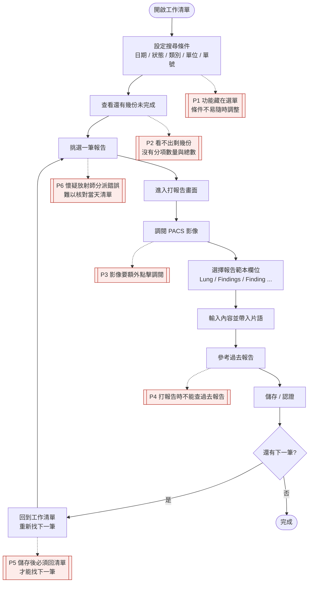

# 影像報告撰寫系統設計（課程案例）

雛型網址：https://jimmy0117.github.io/report-system-design/ （GitHub Pages 發布後可用）

本 repo 是「影像報告撰寫系統」UI/UX 課程案例的設計成果，目前進度為**第一週**：使用者研究與第一版雛型。第二、三週的內容會持續寫在同一個 repo。

| 檔案 | 說明 |
| --- | --- |
| `index.html` | 雛型本體（單一 HTML，直接用瀏覽器開啟即可操作） |
| `slides.html` | 第一週 Demo 簡報（用 Chrome 開啟；← → 切換、F 全螢幕） |
| `tokens.css`、`design-system.md` | 迷你設計系統 |
| `data/` | 模擬資料（`exams.json`、`phrases.json`） |
| `images/` | 影像示意圖 |
| `docs/ai-log.md` | AI 協作日誌 |

> **出處標記**：下文用 〔訪談一·初訪〕〔訪談一·補充 #n〕〔訪談二〕〔訪談三〕 標示依據，對應案例資料的訪談記錄。標示「**推測**」的，是我自己的判斷，訪談中沒有明說。

## 1. 使用者研究

### 醫師人物誌

> 依據訪談一（醫師甲，放射科報告醫師）。訪談中沒有提到年齡、年資、個人背景，所以這份人物誌不虛構這些資料。

**醫師甲｜放射科報告醫師**

| 特質 | 內容 | 出處 |
| --- | --- | --- |
| 主要工作 | 從工作清單開始，連續看影像、撰寫並認證多份報告 | 案例資料「設計範圍」；〔訪談一〕 |
| 使用多種範本 | 門診放射（Finding、Impression）、健檢胸部 X 光（Lung、Others、Suggestion）、健檢 2D+3D 乳攝（Findings、Diagnosis，不要 Breast 欄位） | 〔訪談一·初訪〕 |
| 常用片語、配合中翻英 | 健檢範本需要片語並配合中翻英；門診放射一開始說不需要，約六週後改口要有範本與片語設定 | 〔訪談一·初訪〕〔訪談一·補充末段〕 |
| 靠搜尋條件找單 | 常用條件：檢查日期／報告日期、報告是否完成、檢查類別、開單單位、開單醫師、報告醫師、單號、身分證字號；希望條件直接列在清單上方 | 〔訪談一·初訪〕 |
| 清單習慣 | 每個欄位可排序；預設依檢查日期時間排序、登入醫師即報告醫師；依狀態不同底色「很好」 | 〔訪談一·初訪〕 |
| 在意連續作業的效率 | 不想每打完一份就回清單：要「上一筆／下一筆」，儲存後直接跳到下一筆要打的報告 | 〔訪談一·初訪〕〔補充 #7、#8〕 |
| 要隨時掌握剩餘量 | 要看到還有多少份沒打，要有分項數量與總數，位置要明顯、不要放太下面 | 〔補充 #2〕 |
| 影像與報告在同一畫面 | 點報告就直接看到影像，不想再按「調閱影像」；也想查過去報告並預覽、帶入 | 〔訪談一·初訪〕〔補充 #3、#5〕 |
| 會參考他院系統 | 認為 B 醫院系統列出目前報告與上、下一筆資料是優點 | 〔訪談一·初訪〕 |
| 不信任上游分派 | 擔心放射師沒有正確分派報告，因此要能依日期查當天該打的報告清單 | 〔補充 #4〕 |
| 對現行系統不滿 | 功能藏在選單裡，畫面其實有很多空白處可以直接呈現 | 〔訪談一·初訪〕 |
| 與放射師分開使用 | 醫師與放射師的介面要分開，不要互相干擾 | 〔補充 #1〕 |
| *（推測）注意力在影像與文字之間來回* | 一份報告要同時看影像和填欄位，所以影像區與欄位應並排、不需捲動切換 | **推測**：來自「影像直接呈現」的需求，訪談沒有直接說 |
| *（推測）希望少用滑鼠* | 「上一筆／下一筆」「儲存後跳下一筆」都是為了少一次點擊 | **推測**：技術員乙才明確提到快速鍵 F9，醫師甲沒有說 |

### 醫師任務流程

紅色節點是現行系統的痛點發生處（編號對應下方痛點表）。

> 步驟 F「調閱影像」依〔補充 #5〕「無須醫師點『調閱影像』」反推為現行流程，訪談沒有逐步描述現行操作，流程屬**推測**。

### 痛點

| 痛點 | 出處 | 對醫師的影響 |
| --- | --- | --- |
| P1 現行系統把許多功能藏在選單，畫面空白處卻沒用到；搜尋條件不能直接在清單上方調整 | 〔訪談一·初訪〕 | 每次換條件都要多點幾層，打斷連續作業 |
| P2 看不出還有多少報告沒打（沒有分項數量與總數） | 〔補充 #2〕 | 無法安排工作量，也不確定今天是否打完 |
| P3 影像要另外點「調閱影像」才出現 | 〔補充 #5〕；〔初訪〕點清單就開 PACS 為期望 | 每份報告多一個動作，累積起來很花時間 |
| P4 打報告頁面不能查詢過去影像與報告 | 〔補充 #3〕；〔初訪〕過去報告清單可預覽、帶入 | 要離開畫面去查，無法直接比對或帶入既有內容 |
| P5 儲存後要回清單才能找下一筆 | 〔初訪〕B 醫院優點；〔補充 #8〕 | 連續作業被打斷，多出「回清單→找單→點選」的步驟 |
| P6 放射師可能沒有正確分派報告，醫師難以核對 | 〔補充 #4〕 | 漏打或打到不該打的報告；對清單的信任度低 |
| P7 清單看不出是否有影像、是否已打報告（放射師端更明顯） | 〔訪談二〕 | 醫師需點進去才知道單是否可打 |
| P8 已 DC 的醫令單處理方式不明，且各角色期望不同 | 〔訪談二〕；〔訪談三〕 | 打了不需要的報告，或找不到仍有影像的單 |

> P7 的出處是放射師的需求，在醫師端我把它轉為「清單要看得出影像與報告狀態」，這是**推測**。

## 2. 需求矛盾與設計決定

| 議題 | 不一致的說法 | 我的設計決定 | 理由 |
| --- | --- | --- | --- |
| 門診放射要不要片語 | 同一位受訪者前後不同：〔訪談一·初訪〕「不需要片語」；〔補充末段〕更正為「要有範本與片語設定」 | 門診放射提供 Finding／Impression 欄位與片語 | 補充是較晚的更正，且訪談者特別註明；多一個可忽略的片語，比缺少片語的代價低 |
| 已 DC 的單要不要留在清單 | 〔訪談三〕技術員乙：「已 DC 的醫令單不要出現在清單上」；〔訪談二〕放射師：已照→保留並標示已 DC，未照→從清單移除 | 採放射師規則：已 DC 且已照 → 保留，以灰底、刪除線單號、「⊘ 醫令已DC」標籤標示，且不計入未完成數；已 DC 且未照 → 預設隱藏，並提供「顯示『已DC且未照』的單」核取方塊 | 已照代表影像已存在，可能仍有人要確認；未照沒有任何可打的內容。技術員乙的需求在超音波清單，不在醫師報告清單，用核取方塊保留彈性。**R0004、R0008 各驗證一種情況** |
| 清單預設看誰的單 | 〔初訪〕預設登入醫師為報告醫師；〔補充 #4〕又擔心放射師分派錯，要能查當天全部清單 | 預設只看自己的報告；報告醫師篩選可改成「全部醫師／未指派」，摘要列顯示「尚未指派：N 筆」並提供「查看」捷徑 | 兩者其實不衝突：日常看自己的、需要時能核對。未指派筆數放在摘要列，不必進篩選才知道 |
| 未完成數量放哪裡 | 〔初訪〕搜尋條件要列在清單上方；〔補充 #2〕未完成數量「不要放太下面、要明顯」 | 摘要列（大數字＋分項）放在最上方，搜尋條件緊接其後，兩者都在清單之上 | 兩個要求都在「上方」，只需決定先後；數量是進入頁面第一眼要看的資訊，所以放最上面 |
| 狀態怎麼標示 | 〔初訪〕依狀態不同底色；〔訪談二〕整筆變綠，影像與報告欄位用 V 標註；〔訪談三〕要 check 階段註記 | 底色＋左側色條＋文字標籤＋圖示一起使用（見 `design-system.md`）；不使用整筆變綠 | 只靠顏色對色覺異常者不友善；「整筆變綠」難以區分多種狀態 |
| 影像怎麼出現 | 〔初訪〕點清單就開 PACS；〔補充 #5〕影像直接呈現；〔訪談三〕F9 開啟／關閉影像 | 進入打報告畫面時影像預設顯示在左側。F9 開關列為進階項目，第一版不做 | 兩位醫師的說法一致（不需額外點擊）；F9 來自技術員乙，屬於其他角色的操作習慣 |

### 描述不清楚、需要再確認的地方

| 問題 | 出處 | 目前的處理（**推測**） |
| --- | --- | --- |
| 「check」階段與「已完成」「已認證」的關係？是醫師的步驟還是技術員的步驟？資料中只有三種報告狀態 | 〔訪談三〕 | 第一版只做資料中的三種狀態：未完成、已完成、已認證，不做 check |
| 「未完成報告」的總數是否包含已 DC？ | 〔補充 #2〕 | 不包含已 DC |
| 已 DC 但已照的報告（R0004）醫師還要不要打？ | 〔訪談二〕只說保留並標示 | 保留可開啟、可儲存，並在畫面上方顯示橫幅提醒確認 |
| 醫師可以打別人或未指派的報告嗎？ | 訪談未提 | 只能檢視，不能儲存或認證；已認證的報告同樣唯讀 |
| 哪些欄位必填？ | 訪談未提 | 每個範本的主要欄位必填（Lung、Findings、Finding、Impression、Diagnosis），Others 與 Suggestion 選填 |
| 清單要依「報告日期」搜尋，但資料沒有報告日期；個案資訊要「開單日期」，資料也沒有 | 〔訪談一·初訪〕 | 只做依檢查日期的篩選；個案資訊只顯示檢查日期時間 |
| 受訪者提供的 A、B 醫院系統截圖不在教材中 | 案例資料 | 無法比對 B 醫院「上一筆／下一筆」的實際外觀，只依文字描述設計 |

## 3. 設計範圍

- 本設計涵蓋（基礎軌）：
  - **醫師工作清單**：篩選（醫師、日期、狀態、類別、開單單位、開單醫師、單號／身分證）、每個欄位可排序、依報告狀態呈現底色與標籤、明顯顯示未完成報告的分項數量與總數、已 DC 醫令的呈現方式
  - **打報告畫面**：個案必要資訊、影像示意區、依檢查類別切換的範本欄位、片語帶入、上一筆／下一筆、儲存（或認證）後自動跳到下一筆未完成
  - **可用性目標**：測試者不需要說明，就能完成「連續完成三份報告」的任務
- 不涵蓋及原因：
  - 與外部系統或儀器整合（PACS 自動取影像、動態影像、影像順序、超音波 SR 數值、HIS 診斷與 S／O、依班表自動指派、中英翻譯）：案例資料明訂不在課程範圍，只用示意方式標出位置
  - 資料庫、登入、資料保存：資料只存在瀏覽器，重新整理即恢復原狀
  - 放射師、超音波技術員的介面（含取消認證、批次指派）：醫師與放射師介面要分開〔補充 #1〕，本版只做醫師端
  - 進階軌（放射師介面、鍵盤操作、報告狀態呈現的進階版、過去報告、響應式、無障礙、A/B）：尚未選定，第二週前決定。目前已先做到：以顏色＋文字＋圖示呈現狀態、鍵盤可操作列與按鈕、焦點外框、版面在小螢幕變單欄（為日後的無障礙與響應式打底）

## 4. 設計變數與回應

*（第二週填寫）*

- 收到的變數：
- 影響分析：
- 回應方式（全面調整／部分調整／協商）與理由：

## 5. 設計演進

### 第一版

**做了什麼**：單頁 HTML 互動雛型（`index.html`），資料來自 10 筆模擬檢查。

| 畫面 | 重點 |
| --- | --- |
| 醫師工作清單 | 最上方是「我的未完成報告 3 份／共 4 份」與各類別數量（可點選快速篩選）；下方是搜尋條件列與可排序的清單。已 DC 且已照的 R0004 保留並標示、已 DC 且未照的 R0008 預設隱藏；R0006、R0008、R0009 尚未指派，可從摘要列「查看」 |
| 打報告畫面 | 上方是個案資訊；左側影像示意區（未照則顯示「尚無影像」）；右側依檢查類別切換欄位與片語；底部固定操作列：上一筆／下一筆、儲存、認證 |

**第一版完成標準自我檢查**

- [x] 工作清單使用模擬資料，能看出未完成報告的數量與報告狀態
- [x] 點選一筆可進入打報告畫面，有影像示意區與依檢查類別切換的範本欄位
- [x] 可以輸入報告、儲存，並跳到下一筆未完成的報告（已用自動化腳本驗證：R0001 → R0002 → R0010 → 回清單，且自動略過已 DC 的 R0004）

**已知限制（留給第二、三週）**：沒有鍵盤快速鍵；未做過去報告查詢；尚未做可用性測試，不知道真實醫師是否看得懂「儲存」與「認證」兩個按鈕的差異。

### 替代方案與選擇理由

*（第二週填寫）*

### 啟發式評估與設計變數後的修改

*（第二週填寫）*

### 可用性測試後的修改

*（第三週填寫）*
